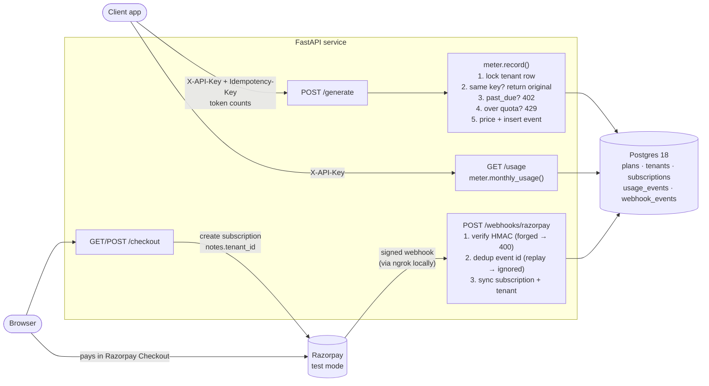

# LLM Usage Metering & Billing Engine

A small, deliberately minimal billing engine for LLM usage. Tenants get a monthly quota from their plan (Free / Pro).
Every billable call is metered exactly once, checked against the quota, and valued at the model provider's token rates.
Tenants **pay** only the subscription price; the token cost is a figure, not a charge (see
[What the customer pays vs. what usage costs](#what-the-customer-pays-vs-what-usage-costs)).
Pro subscriptions are paid through **Razorpay** (test mode); the database mirrors Razorpay only through signed webhooks.

- **Meter:** `POST /generate` records one usage event per `Idempotency-Key`. Over quota → **429**; subscription halted after all payment retries failed → **402**.
- **Read:** `GET /usage` shows this month's calls, tokens and cost against the plan's limits.
- **Pay:** `/checkout` → Razorpay Checkout → signed webhook → tenant plan updated.

AI tokens are simulated: the caller sends token counts, and no model is called.

| Doc | What's in it |
|-----|--------------|
| [DESIGN.md](DESIGN.md) | Schema, API contract, idempotency strategy, cost formula, webhook handling, and the reasons behind each |
| [EVIDENCE.md](EVIDENCE.md) | One captured proof per requirement |
| [BUILDLOG.md](BUILDLOG.md) | Stage-by-stage build record: decisions, bugs, fixes |

## Architecture



One transaction per request: a rejected call stores nothing, and a webhook's dedup row commits together with the plan change.

## Plans

| Plan | API calls / month | Tokens / month | Price | How a tenant gets it |
|------|------------------:|---------------:|-------|----------------------|
| Free | 1,000 | 100,000 | ₹0 | default |
| **Pro** | **50,000** | **10,000,000** | ₹2,499 / month, set on the Razorpay plan (not in code) | Razorpay subscription (`subscription.activated`) |

Months are calendar months in **UTC**. Token quota counts `input + output` tokens (cached and reasoning tokens are
already part of those). A request that **would** cross a limit is rejected whole.

## Token cost (provider rates)

The cost figure reported by `/usage` (not charged to anyone). Pinned in [`app/pricing.py`](app/pricing.py): OpenAI **gpt-6.1-sol**, Standard tier, short context
([source](https://developers.openai.com/api/docs/pricing), read 2026-10-12), USD per 1M tokens:

| Input | Cached input | Output (includes reasoning) |
|------:|-------------:|----------------------------:|
| $2.00 | $0.10 | $10.00 |

```
cost = ((input − cached) × 2.00 + cached × 0.10 + output × 10.00) / 1,000,000
```
Token fields follow OpenAI's usage shape: `cached_input_tokens ⊂ input_tokens` and `reasoning_tokens ⊂ output_tokens`.
Each category is priced at its own rate before summing, and reasoning is counted once, as output.

## What the customer pays vs. what usage costs

Two different numbers, in two currencies. Only the first is ever charged.

| | Subscription price | `cost_usd` in `/usage` |
|---|---|---|
| What it is | What the tenant **pays** for the plan | What the tenant's usage **would cost** at the model provider's token rates |
| Amount | Free ₹0; Pro **₹2,499 / month** (our test setup) | Sum of the per-event costs this month |
| Currency | INR, the Razorpay plan's currency | USD, the provider's price currency |
| Where it's set | On the **Razorpay plan** in the dashboard; not stored or known by this engine | `app/pricing.py` (pinned) |
| Charged? | **Yes**, automatically every month by Razorpay through the mandate | **No.** No invoice, no overage charge (out of scope per the brief) |

- **The subscription buys quota.** ₹2,499/month gives 50,000 calls and 10,000,000 tokens. The engine only learns
  *whether* the tenant paid (webhooks: `charged` keeps Pro, `halted` → 402, `cancelled` → Free), never *how much*.
  Changing the price in the Razorpay dashboard needs no code change.
- **`cost_usd` is a cost figure, not a bill.** It answers "what did this tenant's usage cost us at the provider's
  rates?", which is what the brief's "monthly usage rolls up into a cost figure per tenant" asks for. It stays in USD
  because the provider prices in USD; converting would mean pinning an exchange rate for a number nobody is charged.
- **Why it matters: margin.** At the pinned rates, a Pro tenant using its full 10M tokens costs between **$1**
  (all cached input) and **$100** (all output). Compare that with ₹2,499 at the current exchange rate: a heavy,
  output-heavy Pro tenant can cost more than they pay. `cost_usd` is how you would see that.

## Setup

**Prerequisites:** Docker (OrbStack on macOS), [uv](https://docs.astral.sh/uv/). For real payments you also need a
Razorpay account in **Test Mode** and [ngrok](https://ngrok.com) (free plan).

1. **Configure.** `cp .env.example .env` and fill in:

   | Key | Where it comes from |
   |-----|---------------------|
   | `RAZORPAY_KEY_ID` | Dashboard (Test Mode) → Account & Settings → API Keys (`rzp_test_…`) |
   | `RAZORPAY_KEY_SECRET` | shown once, next to the key id |
   | `RAZORPAY_WEBHOOK_SECRET` | any long random string; paste the same value in the dashboard webhook (step 4) |
   | `RAZORPAY_PLAN_ID` | Dashboard → Subscriptions → Plans → create "Pro", monthly (`plan_…`) |

   The app refuses to start if any key is missing, empty or misspelled. `.env` must contain only these four keys.

2. **Run.**
   ```
   docker compose up -d --build
   curl localhost:8000/health          # {"status":"ok"}
   ```
   The database is created from `schema.sql` and `seed.sql` on first start. Two demo tenants are seeded:
   `demo-key-tenant-a` and `demo-key-tenant-b` (both Free). After changing `schema.sql`, run `docker compose down -v`
   (this **wipes** the dev database).

3. **Test.**
   ```
   uv run pytest
   ```
   Tests use a separate `billing_test` database, rebuilt on every run, so your dev data is never touched.
   The `db` container must be running. Don't run two test sessions at once.

4. **Webhooks (only for real payments).** Razorpay must reach your laptop:
   ```
   ngrok http --url=<your-ngrok-dev-domain> 8000
   ```
   In the Razorpay dashboard → Webhooks, add `https://<your-ngrok-dev-domain>/webhooks/razorpay` (no `:8000`),
   use your `RAZORPAY_WEBHOOK_SECRET`, and tick **all `subscription.*` events**. Without those, only `payment.*`
   events arrive and plans never change.

## Try it

```
# Meter a call (same Idempotency-Key again → same event, "replayed": true)
curl -X POST localhost:8000/generate \
  -H 'X-API-Key: demo-key-tenant-a' -H 'Idempotency-Key: req-1' -H 'Content-Type: application/json' \
  -d '{"input_tokens":10000,"cached_input_tokens":4000,"output_tokens":5000,"reasoning_tokens":2000}'
# {"event_id":…,"cost_usd":"0.0624000000","replayed":false}

# This month's usage and cost
curl localhost:8000/usage -H 'X-API-Key: demo-key-tenant-a'

# Upgrade to Pro: open in a browser, pay with the domestic test card 4718 6091 0820 4366,
# any CVV and future expiry, then click "Success" on the mock bank page
open http://localhost:8000/checkout

# Replay a signed webhook without Razorpay: valid → duplicate ignored → forged 400
uv run scripts/replay_webhook.py [tenant_id]
```

## Endpoints

| Method | Path | Auth | Responses |
|--------|------|------|-----------|
| POST | `/generate` | `X-API-Key`, `Idempotency-Key` | 200 event · 400 no idempotency key · 401 bad key · 402 subscription halted (all payment retries failed) · 422 invalid tokens · 429 quota |
| GET | `/usage` | `X-API-Key` | 200 usage for the current month · 401 |
| GET | `/checkout` | – | Checkout page |
| POST | `/checkout` | `X-API-Key` | 200 `{key_id, subscription_id}` (an unpaid subscription is reused after checking its real status at Razorpay) · 401 · 409 already Pro, or a subscription already authorised/live at Razorpay |
| POST | `/webhooks/razorpay` | Razorpay signature | 200 applied / duplicate ignored / ignored: older than last applied event / ignored: subscription has no tenant_id · 400 bad signature or missing event id |
| GET | `/health` | – | 200 when the database is reachable |

## Project layout

```
app/main.py        routes
app/meter.py       metering: record() + monthly_usage(), quota rules
app/pricing.py     pinned token prices + cost formula
app/billing.py     Razorpay webhook: signature, dedup, plan sync
app/config.py      settings from .env (pydantic-settings)
app/db.py          Postgres connection
app/checkout.html  Razorpay checkout page
schema.sql         tables, constraints, plan limits
seed.sql           demo tenants (dev only)
scripts/replay_webhook.py
tests/             pytest against real Postgres
```

## Out of scope

Invoices, proration, overage billing, dashboards, an admin API, and a migrations tool. Kept out on purpose, per the brief.

**Known limit:** one tenant with several Razorpay subscriptions. Cancelling one while another is active would
downgrade the tenant. `/checkout` never leaves more than one open subscription per tenant (it reuses an unpaid one),
so this only applies to subscriptions created for the same tenant outside `/checkout`, e.g. by hand. See [DESIGN.md](DESIGN.md#known-limits).
